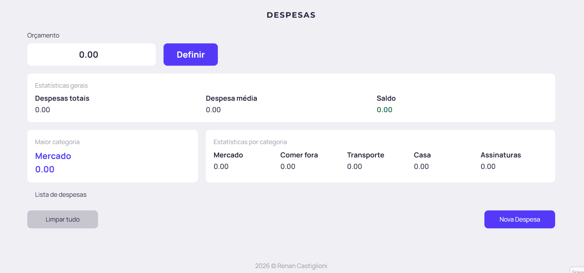

# 💰 Expense Tracker — Controle de Despesas


Aplicação web de **controle financeiro pessoal**, desenvolvida com HTML5, CSS3 e JavaScript puro (Vanilla JS). Permite gerenciar orçamentos, registrar despesas por categoria e acompanhar indicadores financeiros em uma interface interativa e responsiva.

O projeto utiliza manipulação dinâmica do DOM, organização modular do código e persistência de dados por meio da Web Storage API (`localStorage`), sem depender de frameworks ou serviços externos.

**🔗 [Acessar aplicação](https://recastig.github.io/expense-tracker/)**

## 🎬 Demonstração



---

## 📋 Sumário

- [Funcionalidades](#-funcionalidades)
- [Tecnologias utilizadas](#️-tecnologias-utilizadas)
- [Arquitetura do código](#️-arquitetura-do-código)
- [Estrutura do projeto](#-estrutura-do-projeto)
- [Como executar](#-como-executar)
- [Aprendizados técnicos](#-aprendizados-técnicos)
- [Limitações e melhorias futuras](#-limitações-e-melhorias-futuras)
- [Autor](#-autor)

---

## 🚀 Funcionalidades

### 💵 Gerenciamento de orçamento

- Definição e atualização do orçamento disponível.
- Cálculo automático do saldo restante.
- Indicador visual do saldo, com alteração de cor conforme a relação entre despesas e orçamento.
- Atualização dos valores exibidos na interface após as interações.

### 🧾 Controle de despesas

- Cadastro de despesas por meio de formulário modal.
- Organização dos lançamentos por categoria e valor.
- Exclusão individual de despesas.
- Atualização dinâmica da listagem sem recarregar a página.

**Categorias disponíveis:** Mercado, Comer fora, Transporte, Casa e Assinaturas.

### 📊 Indicadores financeiros

Cálculo e atualização automática de:

- Total de despesas registradas.
- Média de gastos por lançamento.
- Saldo disponível.
- Categoria com maior gasto.
- Totais acumulados por categoria.

### 💾 Persistência de dados

- Armazenamento do orçamento e dos lançamentos utilizando `localStorage`.
- Recuperação dos dados salvos ao reabrir a aplicação no mesmo navegador.
- Inicialização com lançamentos de exemplo na primeira utilização.
- Opção **Limpar tudo**, que restaura os lançamentos iniciais de exemplo.

---

## 🛠️ Tecnologias utilizadas

| Tecnologia | Aplicação |
|---|---|
| **HTML5** | Estrutura semântica, formulários e elementos da interface |
| **CSS3** | Estilização, organização visual e responsividade |
| **JavaScript (ES6+)** | Lógica de programação, manipulação do DOM e eventos |
| **Web Storage API** | Persistência dos dados com `localStorage` |
| **Git / GitHub** | Versionamento e documentação |

O projeto foi desenvolvido sem frameworks JavaScript, backend ou banco de dados externo.

---

## 🏗️ Arquitetura do código

A aplicação separa responsabilidades entre cálculos financeiros, manipulação da interface e inicialização.

### Organização dos módulos

| Arquivo | Responsabilidade |
|---|---|
| `calculations.js` | Processamento das despesas, totais e indicadores financeiros |
| `handle-html.js` | Atualização dos elementos da interface e tratamento de interações |
| `index.js` | Inicialização da aplicação e gerenciamento da persistência local |

### Fluxo da aplicação

1. A aplicação é inicializada e recupera os dados armazenados no navegador.
2. Na ausência de dados salvos, utiliza o orçamento e os lançamentos de exemplo.
3. O usuário define seu orçamento e registra ou remove despesas.
4. Os cálculos são atualizados conforme os dados disponíveis.
5. A interface apresenta os novos valores e indicadores.
6. O estado é armazenado em `localStorage` para utilização posterior.

### Conceitos aplicados

- Separação de responsabilidades entre arquivos JavaScript.
- Manipulação e atualização dinâmica do DOM.
- Tratamento de eventos de interface.
- Uso de arrays e operações de cálculo.
- Persistência de dados no navegador.
- Atualização da interface a partir do estado dos dados.

---

## 📁 Estrutura do projeto

```text
expense-tracker/
├── blocks/                  # Estilos organizados por bloco
├── images/                  # Ícones e elementos visuais
├── pages/
│   └── index.css            # Entrada dos estilos
├── public/
│   └── demo/
│       └── NOME-DO-GIF.gif  # Demonstração da aplicação
├── scripts/
│   ├── calculations.js      # Cálculos financeiros
│   ├── handle-html.js       # Interface e eventos
│   └── index.js             # Inicialização e localStorage
├── vendor/                  # Fontes e normalização CSS
├── index.html
└── README.md
```

---

## 📦 Como executar

### Pré-requisitos

- Navegador web atualizado.
- Git (opcional, para clonar o repositório).

### Instalação

1. Clone o repositório:

```bash
git clone https://github.com/recastig/expense-tracker.git
```

2. Acesse o diretório:

```bash
cd expense-tracker
```

3. Abra o arquivo `index.html` no navegador.

4. Defina um orçamento e utilize o botão **Nova Despesa** para cadastrar seus lançamentos.

Não é necessário instalar dependências, configurar variáveis de ambiente ou iniciar um servidor de desenvolvimento.

---

## 📚 Aprendizados técnicos

O desenvolvimento do Expense Tracker permitiu aplicar conceitos fundamentais de programação frontend em uma aplicação funcional.

Entre os principais aprendizados:

- Construção de interfaces interativas com JavaScript puro.
- Separação entre lógica de negócio e apresentação visual.
- Manipulação de arrays e cálculos financeiros.
- Eventos e atualização dinâmica dos elementos HTML.
- Persistência e recuperação de dados com `localStorage`.
- Organização de arquivos e responsabilidades.
- Desenvolvimento de uma interface adaptável a diferentes tamanhos de tela.

---

## 🎯 Limitações e melhorias futuras

O projeto utiliza armazenamento local, portanto os dados permanecem associados ao navegador e dispositivo utilizados.

Possíveis evoluções:

- [ ] Implementar validação mais rigorosa dos valores cadastrados.
- [ ] Permitir limpar completamente a lista de despesas, sem restaurar exemplos.
- [ ] Adicionar gráficos para visualização da evolução dos gastos.
- [ ] Implementar exportação dos lançamentos.
- [ ] Permitir sincronização de dados entre dispositivos.
- [ ] Adicionar testes automatizados.

---

## 👨‍💻 Autor

**Renan Castiglioni**

Projeto desenvolvido para fins educacionais durante a formação em Desenvolvimento Web.

[](https://github.com/recastig)
[](https://www.linkedin.com/in/renancastiglioni/)

**Email:** renan.castiglioni@gmail.com

---

## 📄 Licença

Projeto desenvolvido para fins educacionais durante o bootcamp de Desenvolvimento Web.